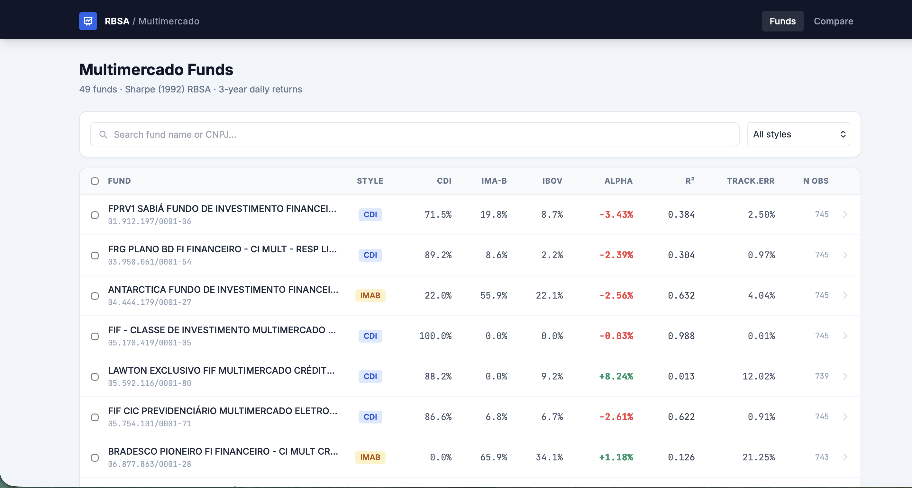

# Style Analysis Dashboard

Decomposição do retorno de fundos multimercado brasileiros em exposições de risco por fator, a partir do modelo de análise de estilo de Sharpe (1992).



---

## O problema

O retorno de um fundo multimercado é frequentemente apresentado como resultado da habilidade do gestor. Parte dele, porém, vem apenas de exposição passiva a fatores de mercado — juros, bolsa, câmbio, inflação. Sem separar as duas coisas, o alpha aparece inflado por fatores omitidos.

Este projeto estima quanto do retorno de cada fundo é explicado por exposição a fatores e quanto sobra como retorno não explicado.

## O método

Regressão do retorno do fundo contra um conjunto de índices de referência, com duas restrições impostas ao estilo de Sharpe (1992):

- os coeficientes somam 1;
- nenhum coeficiente é negativo.

As restrições fazem os coeficientes serem lidos como uma carteira de referência: a combinação de índices que melhor replica o comportamento do fundo. O resíduo da regressão é o retorno não explicado por essa carteira.

A robustez dos coeficientes é avaliada por reestimação em janelas móveis, o que também mostra mudanças de estilo ao longo do tempo.

## Dados

| Fonte | Uso |
|---|---|
| CVM | Cotas diárias dos fundos (759 observações, 49 fundos multimercado) |
| BCB | CDI |
| Yahoo Finance | Proxies de mercado |
| IMA-B | Referência de renda fixa indexada à inflação |

## Resultado

Dos 49 fundos multimercado analisados, 45 (92%) apresentaram exposição dominante ao CDI, e apenas 4 ao IMA-B — nenhum teve o Ibovespa como fator principal. O R² variou amplamente: fundos como a FIF Classe de Investimento (R²=0.988) têm o retorno quase inteiramente explicado pela exposição a juros, enquanto outros, como Gladius e Hans 95, apresentaram R² próximo de zero e alpha extremo (+67% e +38%), sinal de que rodam estratégias não capturadas pelos três fatores de referência — provavelmente crédito privado ou derivativos — e não de geração de retorno genuína. O achado central é que a maioria dos fundos rotulados "multimercado" se comporta, na prática, como exposição concentrada ao CDI.

## Stack

Python · pandas · NumPy · SciPy (otimização com restrições) · Flask · Plotly

## Como rodar

```bash
git clone https://github.com/joaoalbuquerquef/style-analysis.git
cd style-analysis

python -m venv .venv
source .venv/bin/activate
pip install -r requirements.txt

python app.py
```

A aplicação sobe em `http://localhost:5000`.

## Limitações

- A análise de estilo com restrições identifica a carteira de referência que melhor replica o fundo, não a carteira efetivamente detida.
- Fundos com mudança abrupta de mandato no período são mal representados por uma estimação única; daí o uso de janelas móveis.
- Os índices escolhidos como fatores limitam o que o modelo consegue explicar: um fundo exposto a um fator ausente do conjunto terá esse retorno classificado como não explicado.

---

Projeto pessoal de estudo. João Albuquerque.

